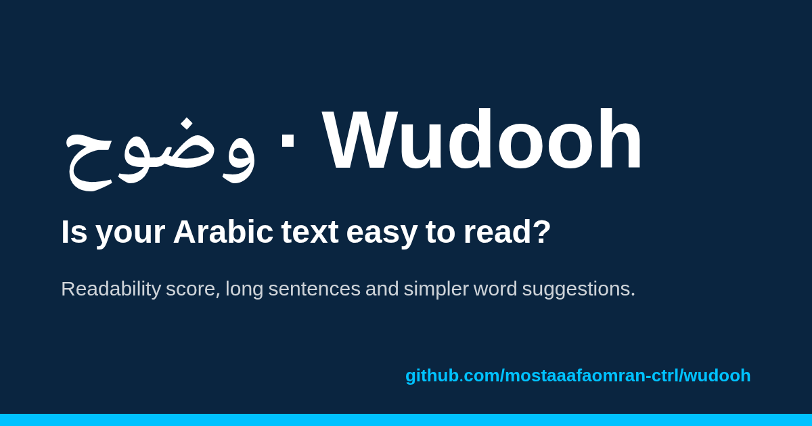

# وضوح · Wudooh

Arabic readability checker.

**Live:** https://mostaaafaomran-ctrl.github.io/wudooh/

## What it does

- Score from 0 to 100 with a level from very easy to very hard
- Highlights long sentences and long words in your text
- Suggests simpler words (Egyptian Arabic) from a built-in list
- Nothing is uploaded, the score is a transparent heuristic

## Use it

Open the live link. No signup, no server. To run it locally, clone the repo and open `index.html` in a browser.

## بالعربي

الصق نص عربي واعرف مدى وضوحه، مع تحديد الجمل الطويلة واقتراح كلمات أبسط.

## License

MIT
